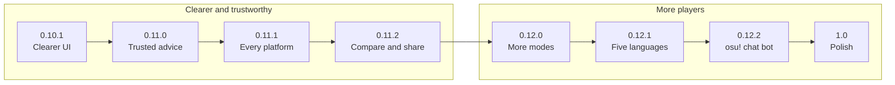

# Roadmap

Where osu! coach is heading on the way to 1.0. This is a plan, not a promise: releases have no fixed dates, and their
content can change as we learn what players need. Each item links to its issue where there is one; ideas and feedback
are welcome in [issues](https://github.com/DeMotione/osu-coach/issues).

Last updated: 2026-10-20 (current release: [0.10.0](https://github.com/DeMotione/osu-coach/releases/tag/v0.10.0)).

0.10.x and the 0.11 series make the app clear and its advice trustworthy; 0.12 then brings it to more modes,
languages and osu! chat. Analysis always stays on your computer. From 0.12.2 osu! coach can also sign in to osu! for
the chat bot; without signing in, everything else works as before.

## 0.10.x: fixes and a clearer UI

Clears the open issues and reworks the pages so each piece of information appears once, with explanations one hover
away.

Fixes:

- [ ] Cancel a running job, such as a map download, so it no longer blocks scanning and imports
  ([#45](https://github.com/DeMotione/osu-coach/issues/45)).
- [ ] Show the map score calculation as readable values instead of raw JSON
  ([#46](https://github.com/DeMotione/osu-coach/issues/46)).
- [ ] Hide maps you have already completed from the playlist, with a "show completed" toggle
  ([#47](https://github.com/DeMotione/osu-coach/issues/47)).
- [x] Rename Map Suggestion to **Skill Development** and Skill Development to **Goals & Training**
  ([#48](https://github.com/DeMotione/osu-coach/issues/48)).

UI rework:

- [ ] A **"?"** next to every section heading. The explanation text under headings moves into a popup that opens on
  hover, keyboard focus or tap, and explains how the section works and how its numbers are calculated.
- [ ] Say each thing once: no text or numbers repeated across pages.
- [ ] Charts any player can read: a title that says what the chart shows, named axes with units, fewer series at
  once, labels on the values that matter, and "how to read this" in its "?".
- [ ] Works on touch screens and in small windows.

## 0.11.0: trustworthy ratings, maps and setup advice

- [ ] **One rating scale.** The comfort-relative skill ratings lose their "experimental" label and replace the old
  scale everywhere, including goals.
- [ ] **Skills against a 10★ reference** that realistically predicts how you would do on a 10★ map
  ([#39](https://github.com/DeMotione/osu-coach/issues/39)).
- [ ] **Rating tests** on fixed sets of replays at several levels, run on every change.
- [ ] **Better map pool** with newer ranked maps and good coverage at every star level and skill.
- [ ] **Better map suggestions**: ranked by how well a map trains the chosen skill at your level, without maps you
  have already passed.
- [ ] **Setup calibration with real answers.** Every setup tip ends in new values: tablet area width, height and
  X/Y, mouse sensitivity, rapid-trigger and SayoDevice settings. "Keep it" only when the change would be within
  noise.
- [ ] **"Use suggested settings" button** in Tips & Setup. One click fills in and saves the suggested values (the
  previous setup can be restored). You still change osu! and your devices (tablet driver, keyboard software) by
  hand; the page lists exactly what to set where.

## 0.11.1: every platform

- [ ] More Linux distributions: an Arch Linux package (`.pkg.tar.zst`,
  [#44](https://github.com/DeMotione/osu-coach/issues/44)), and AppImage or Flatpak for the rest.
- [ ] A macOS app (`.dmg`), signed and notarized.
- [ ] Signed Windows installers, so SmartScreen stops warning.

## 0.11.2: compare and share

- [ ] **"Compare" on every page.** Pick any earlier date or period (or a quick pick such as yesterday, last week,
  last month) and the page shows then against now. Only the numbers that changed meaningfully stand out, so the
  screen never fills up.
- [ ] **Profile card and report.** Export a share image (level, top skills, recent progress) and a longer report
  (PDF).

## 0.12.0: taiko, catch and mania

- [ ] A new setup step: **which modes do you play?** (several allowed, changeable later).
- [ ] For each mode, the same depth as osu!standard: replays judged with the mode's own rules for stable and lazer,
  skills that fit the mode, setup tips and a map pool.

## 0.12.1: five languages

- [ ] English, Russian, Spanish, French and German, chosen in the setup guide or settings (default: your system
  language).
- [ ] Every text translated, including tips and explanations.

## 0.12.2: osu! chat bot

- [ ] **Sign in with osu!** in osu! coach.
- [ ] A bot in osu! chat that sends you a playlist or beatmaps for a skill, tells you what to improve next, and
  analyses a beatmap you send it.

## Before 1.0

No new features after 0.12.2: polish everything, fix the bugs 0.12.x brings, and make the improvements players ask
for. Release candidates come first; 1.0 ships when there are no open bugs and every installer has been tested on its
platform.

## Open for discussion

- How should the chat bot get your data: by asking your running app (data stays on your computer, but the bot only
  answers while the app is open), or from a summary the app uploads (the bot answers anytime)?
- Should taiko, catch and mania arrive together, or one mode per release, and which first?
- Help wanted: translators and reviewers for Russian, Spanish, French and German.
- Not scheduled yet: a training loop (goal, playlist, new plays, goal progress), analysing new replays automatically
  while osu! runs, and a report after each session.
