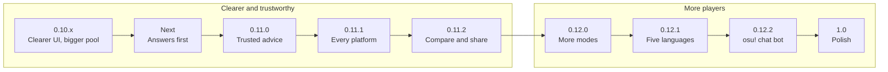

# Roadmap

Where osu! coach is heading on the way to 1.0. This is a plan, not a promise: releases have no fixed dates, and their
content can change as we learn what players need. Each item links to its issue where there is one; ideas and feedback
are welcome in [issues](https://github.com/DeMotione/osu-coach/issues).

Last updated: 2026-11-26 (current release: [0.10.3](https://github.com/DeMotione/osu-coach/releases/tag/v0.10.3)).

0.10.x and the 0.11 series make the app clear and its advice trustworthy; 0.12 then brings it to more modes,
languages and osu! chat. Analysis always stays on your computer. From 0.12.2 osu! coach can also sign in to osu! for
the chat bot; without signing in, everything else works as before.

## Released in 0.10.x

0.10.0 to 0.10.3 cleared the open issues, reworked the pages and grew the map pool ten times.

- [x] **Play Goals**: FC a map, Farm PP and Improve a mod (HD / DT), with concrete play objectives.
- [x] Cancel a running job, such as a map download, so it no longer blocks scanning and imports
  ([#45](https://github.com/DeMotione/osu-coach/issues/45)).
- [x] Show the map score calculation as readable values instead of raw JSON
  ([#46](https://github.com/DeMotione/osu-coach/issues/46)).
- [x] Hide maps you have already completed from the playlist, with a Completed maps list
  ([#47](https://github.com/DeMotione/osu-coach/issues/47)).
- [x] Rename Map Suggestion to **Skill Development** and Skill Development to **Goals & Training**
  ([#48](https://github.com/DeMotione/osu-coach/issues/48)).
- [x] A **"?"** next to every section heading: how the section works and how its numbers are calculated, one hover,
  focus or tap away.
- [x] Works on touch screens and in small windows.
- [x] An Arch Linux package (`.pkg.tar.zst`, [#44](https://github.com/DeMotione/osu-coach/issues/44)).
- [x] New plays are analysed by themselves while osu! coach is open
  ([#71](https://github.com/DeMotione/osu-coach/issues/71)).
- [x] **A map pool of ~50,000 ranked maps** instead of ~5,000
  ([#96](https://github.com/DeMotione/osu-coach/issues/96)), with mods (HR, HD, any DT speed from 1.10× to 2.00×)
  ([#98](https://github.com/DeMotione/osu-coach/issues/98)). A bundled table of every pool map with every mod makes a
  search with mods take seconds, without downloading any map.
- [x] **Faster analysis** ([#95](https://github.com/DeMotione/osu-coach/issues/95)): analyse your latest 100, 500 or
  1000 replays of the last year, with the time it will take shown before you start and a screen that covers the app
  while it runs. The pages of the last analysis are back at once when the app starts
  ([#97](https://github.com/DeMotione/osu-coach/issues/97)).
- [x] **Star Levels** (experimental) next to Comfort Score: each skill as the map star rating it holds up on.
- [x] Playlists stay as you left them when you switch tabs or start the app again
  ([#107](https://github.com/DeMotione/osu-coach/issues/107)).
- [x] osu!lazer: playlist maps go straight into lazer, and each map opens in lazer from the app.

## Next release: answers first

Already on `main`, not released yet.

- [x] Star ratings follow osu!'s 2026 star rating update ([#128](https://github.com/DeMotione/osu-coach/issues/128)).
- [x] **FC a map** redesigned: find the map among all your replays and pick a replay
  ([#127](https://github.com/DeMotione/osu-coach/issues/127)).
- [x] Star Levels: goals in stars ([#129](https://github.com/DeMotione/osu-coach/issues/129)), and no "Try other skill
  ratings" in its playlists ([#126](https://github.com/DeMotione/osu-coach/issues/126)).
- [x] Setup Tips check a changed setting only on the plays made with it
  ([#131](https://github.com/DeMotione/osu-coach/issues/131)).
- [x] Play Goals search the whole pool, with custom DT speeds.
- [x] Settings: the osu! installs to read and whether to download missing beatmaps, chosen once.
- [x] **Charts that say the answer first.** Every chart starts with one sentence and its key number (what it means
  for you), marks what is clearly worse or better than your average, and leaves out what is too little to tell.
- [x] Slider misses by length and speed in one chart ([#142](https://github.com/DeMotione/osu-coach/issues/142)), and
  the slider and reading numbers in one block ([#143](https://github.com/DeMotione/osu-coach/issues/143)).
- [x] **"Practise this" makes the playlist for the weak spot found**
  ([#144](https://github.com/DeMotione/osu-coach/issues/144)): streams at the BPMs where your timing spreads, jumps
  into the part of the screen you miss, sliders of the length you break, and so on.

## 0.11.0: trustworthy ratings, maps and setup advice

- [ ] **One rating scale.** Comfort Score and Star Levels (experimental) sit side by side since 0.10.3; one of them
  becomes the scale everywhere, including goals, once Star Levels is fitted on other players' replays (see
  [docs/star-scale-irt.md](docs/star-scale-irt.md)).
- [x] **Skills against a 10★ reference** that realistically predicts how you would do on a 10★ map
  ([#39](https://github.com/DeMotione/osu-coach/issues/39)).
- [ ] **Rating tests** on fixed sets of replays at several levels, run on every change.
- [x] **Better map pool** with newer ranked maps and good coverage at every star level and skill
  ([#96](https://github.com/DeMotione/osu-coach/issues/96)).
- [x] **Better map suggestions**: ranked by how well a map trains the chosen skill at your level, without maps you
  have already passed ([#32](https://github.com/DeMotione/osu-coach/issues/32),
  [#33](https://github.com/DeMotione/osu-coach/issues/33), [#47](https://github.com/DeMotione/osu-coach/issues/47)).
- [ ] **Say each thing once**: no text or numbers repeated across pages.
- [ ] **Setup calibration with real answers.** Every setup tip ends in new values: tablet area width, height and
  X/Y, mouse sensitivity, rapid-trigger and SayoDevice settings. "Keep it" only when the change would be within
  noise.
- [ ] **"Use suggested settings" button** in Setup Tips. One click fills in and saves the suggested values (the
  previous setup can be restored). You still change osu! and your devices (tablet driver, keyboard software) by
  hand; the page lists exactly what to set where.

## 0.11.1: every platform

- [ ] AppImage or Flatpak for the Linux distributions without a package.
- [ ] A macOS app (`.dmg`), signed and notarized.
- [ ] Signed Windows installers, so SmartScreen stops warning.

## 0.11.2: compare and share

- [ ] **"Compare" on every page.** Pick any earlier date or period (or a quick pick such as yesterday, last week,
  last month) and the page shows then against now. Only the numbers that changed meaningfully stand out, so the
  screen never fills up.
- [ ] **Profile card and report.** Export a share image (level, top skills, recent progress) and a longer report
  (PDF).

## 0.12.0: taiko, catch and mania

- [ ] A new setup step: **which modes do you play?** (several allowed, changeable later).
- [ ] For each mode, the same depth as osu!standard: replays judged with the mode's own rules for stable and lazer,
  skills that fit the mode, setup tips and a map pool.

## 0.12.1: five languages

- [ ] English, Russian, Spanish, French and German, chosen in the setup guide or settings (default: your system
  language).
- [ ] Every text translated, including tips and explanations.

## 0.12.2: osu! chat bot

- [ ] **Sign in with osu!** in osu! coach.
- [ ] A bot in osu! chat that sends you a playlist or beatmaps for a skill, tells you what to improve next, and
  analyses a beatmap you send it.

## Before 1.0

No new features after 0.12.2: polish everything, fix the bugs 0.12.x brings, and make the improvements players ask
for. Release candidates come first; 1.0 ships when there are no open bugs and every installer has been tested on its
platform.

## Open for discussion

- How should the chat bot get your data: by asking your running app (data stays on your computer, but the bot only
  answers while the app is open), or from a summary the app uploads (the bot answers anytime)?
- Should taiko, catch and mania arrive together, or one mode per release, and which first?
- Help wanted: translators and reviewers for Russian, Spanish, French and German.
- Not scheduled yet: a training loop (goal, playlist, new plays, goal progress) and a report after each session.
